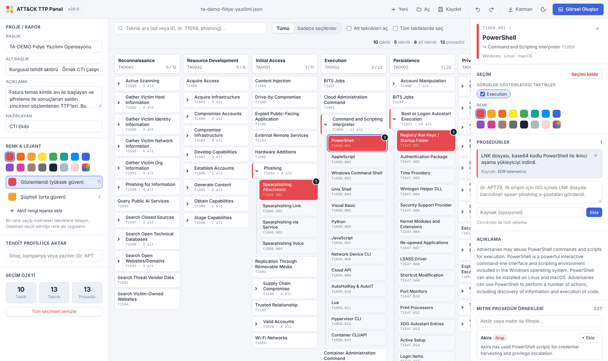
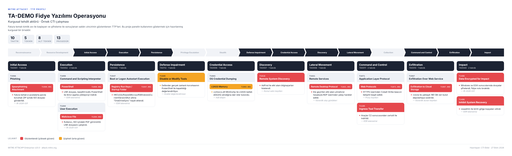
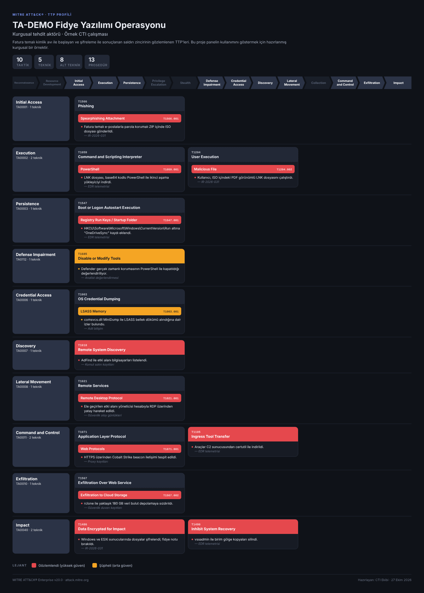
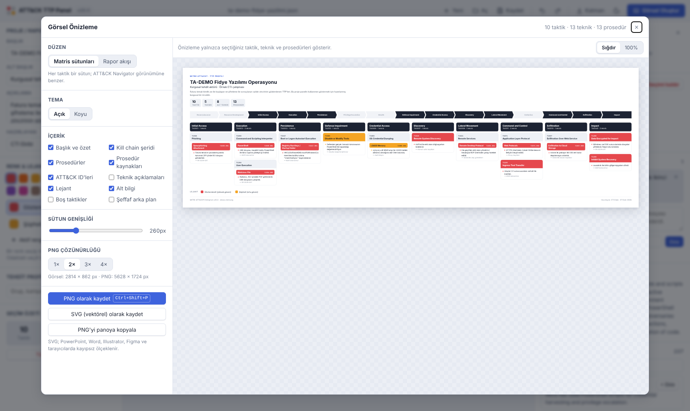

# ATT&CK TTP Panel

**MITRE ATT&CK® Enterprise v20** üzerinde tehdit aktörünün kullandığı **taktik, teknik
ve prosedürleri (TTP)** seçip renklendirmenizi ve **yalnızca seçtiklerinizi** gösteren
temiz bir görseli **PNG** ya da **SVG (vektörel)** olarak kaydetmenizi sağlayan masaüstü paneli.
CTI raporları, sunumlar ve olay müdahale özetleri için tasarlandı.

| Windows | macOS |
| --- | --- |
| [Windows sürümü →](windows/README.md) | [macOS sürümü →](mac/README.md) |
| Kurulum sihirbazı, taşınabilir `.exe`, zip — x64 & ARM64 | Universal `.dmg` — Apple Silicon & Intel |



## Ortaya çıkan görsel

Panelde ne seçtiyseniz görselde yalnızca o vardır: kullanılan taktikleri vurgulayan bir
kill chain şeridi, taktik sütunları, renklendirilmiş teknik kartları, ana tekniğin altında
toplanan alt teknikler ve kaynaklarıyla birlikte prosedürler.



<details>
<summary>Koyu tema · rapor akışı düzeni</summary>



</details>

## Özellikler

**Seçim ve renklendirme**
- ATT&CK v20 Enterprise matrisinin tamamı: 15 taktik, 227 teknik, 479 alt teknik — çevrimdışı çalışır.
- Bir hücreye tıklamak tekniği aktif renkle seçer, tekrar tıklamak kaldırır.
  `Shift`+tık / sağ tık yalnızca ayrıntıları açar.
- Teknik varsayılan olarak **yalnızca tıkladığınız taktik sütununda** seçilir
  (ör. *Valid Accounts* sadece *Initial Access* altında). İsterseniz “Tüm taktiklerde seç”.
- Taktik başlıklarına tıklayarak taktikleri de seçip renklendirebilirsiniz.
- Renk paleti + düzenlenebilir **lejant** (ör. “Gözlemlendi (yüksek güven)”, “Şüpheli”).
  Lejant rengini değiştirmek o rengi kullanan tüm seçimleri günceller.
- Arama (ad veya ID), “Sadece seçilenler” görünümü, alt teknikleri aç/kapat.

**Prosedürler**
- Her tekniğe kaynağıyla birlikte serbest metin prosedürler ekleyin (`Ctrl/⌘+Enter`).
- MITRE'nin **gruplar, kampanyalar ve yazılımlar** için yayımladığı prosedür örneklerini
  tek tıkla ekleyin (aktör veya metne göre filtrelenebilir).
- **Tehdit profili içe aktarma:** APT29, FIN7, Lazarus… 1000'den fazla grup/kampanya/yazılımın
  tüm tekniklerini ve prosedürlerini tek adımda seçin, sonra kendi bulgularınıza göre düzenleyin.

**Dışa aktarma**
- Canlı önizlemeli **Görsel Oluştur** penceresi:
  matris sütunları veya rapor akışı düzeni, açık/koyu tema, şeffaf arka plan,
  başlık/özet, kill chain şeridi, prosedürler, kaynaklar, ID'ler, açıklamalar, lejant, alt bilgi.
- **PNG** (1×–4× çözünürlük), **SVG** (PowerPoint, Word, Illustrator, Figma'da kayıpsız) ve
  **panoya kopyala**.
- Uzun prosedürleri 1/2/4 satıra kısaltma — büyük profillerde görsel kompakt kalır.
- **Rapor tablosu:** seçili TTP'leri Markdown (.md) veya CSV (Excel) olarak kaydedin
  ya da Markdown tablosunu panoya kopyalayıp rapora/wiki'ye yapıştırın.
- **ATT&CK Navigator** katmanı (layer 4.5) içe/dışa aktarma — renkler, taktik bazlı
  seçimler, lejant ve prosedürler korunur.

**Proje**
- Projeler `.json` olarak kaydedilir; çalışma her değişiklikte otomatik saklanır.
- Geri al / yinele, sürükle-bırak ile dosya açma, açık/koyu/sistem teması.
- Pencere boyutu ve konumu hatırlanır.

## Hızlı başlangıç

1. Sol panelde **Başlık** ve **Alt başlık** girin (görselin başlığı olur).
2. Paletten bir renk seçin ve matriste aktörün kullandığı tekniklere tıklayın —
   ya da **Tehdit Profili İçe Aktar** bölümünden bir grup seçin.
3. Sağ panelde tekniğe prosedür ekleyin, rengini veya gösterileceği taktikleri değiştirin.
4. **Görsel Oluştur** → düzeni seçin → **PNG** veya **SVG** olarak kaydedin.



## Kısayollar

| İşlem | Windows | macOS |
| --- | --- | --- |
| Yeni / Aç / Kaydet | `Ctrl+N` / `Ctrl+O` / `Ctrl+S` | `⌘N` / `⌘O` / `⌘S` |
| Farklı kaydet | `Ctrl+Shift+S` | `⇧⌘S` |
| Görsel önizleme | `Ctrl+E` | `⌘E` |
| PNG / SVG kaydet | `Ctrl+Shift+P` / `Ctrl+Shift+E` | `⇧⌘P` / `⇧⌘E` |
| Navigator katmanı içe aktar | `Ctrl+I` | `⌘I` |
| Ara | `Ctrl+F` | `⌘F` |
| Sadece seçilenler | `Ctrl+L` | `⌘L` |
| Alt teknikleri aç/kapat | `Ctrl+B` | `⌘B` |
| Geri al / Yinele | `Ctrl+Z` / `Ctrl+Y` | `⌘Z` / `⇧⌘Z` |
| Odaktaki tekniğin seçimini kaldır | `Delete` | `⌫` |

## Kaynak koddan çalıştırma

[Node.js 22+](https://nodejs.org) gerekir.

```bash
git clone https://github.com/exseron/mitre-navigator-v20.git
cd mitre-navigator-v20
npm install
npm start
```

Windows'ta `windows\start.bat`, macOS'ta `mac/start.command` aynı işi çift tıklamayla yapar.
Panel bir tarayıcıda da açılabilir: `src/renderer/index.html` (bu durumda dosyalar indirme olarak kaydedilir).

## Paketleme

| Komut | Çıktı |
| --- | --- |
| `npm run build:win` | `dist/windows/` — NSIS kurulum (x64, ARM64), taşınabilir `.exe`, zip |
| `npm run build:mac` | `dist/mac/` — Universal `.dmg` ve zip (yalnızca macOS'ta) |

GitHub Actions ([`.github/workflows/build.yml`](.github/workflows/build.yml)) her push'ta
testleri çalıştırır, Windows ve macOS paketlerini derleyip artifact olarak yükler.
`v1.0.0` gibi bir etiket gönderildiğinde paketler otomatik olarak bir GitHub Release'e eklenir:

```bash
git tag v1.0.0 && git push origin v1.0.0
```

## ATT&CK verisini güncelleme

Paketlenmiş veri `src/renderer/data/attack-data.js` dosyasındadır ve resmi
[attack-stix-data](https://github.com/mitre-attack/attack-stix-data) deposundan üretilir:

```bash
npm run data:update   # en güncel enterprise-attack.json'u indirir ve dönüştürür
npm run data:build    # data/raw/enterprise-attack.json'dan yeniden üretir
```

## Proje yapısı

```
src/main/            Electron ana süreç (pencere, menü, dosya diyalogları, preload)
src/renderer/        Arayüz (HTML/CSS/JS), görsel üretici ve ATT&CK verisi
  js/exporter.js     Seçimlerden SVG/PNG görsel üretimi
  js/layer-io.js     Proje ve ATT&CK Navigator katmanı dönüşümleri
  js/table-export.js Markdown / CSV rapor tablosu
  js/store.js        Durum, geri al/yinele, otomatik kayıt
scripts/             STIX → panel verisi dönüştürücü
windows/             Windows paketleme ayarları ve .bat betikleri
mac/                 macOS paketleme ayarları, entitlements ve betikler
examples/            Örnek proje, Navigator katmanı ve çıktı görselleri
test/                node:test birim testleri (npm test)
```

## Lisans

Kod MIT lisanslıdır ([LICENSE](LICENSE)). MITRE ATT&CK® içeriği © The MITRE Corporation'a aittir
ve [ATT&CK Kullanım Koşulları](https://attack.mitre.org/resources/legal-and-branding/terms-of-use/)
kapsamında kullanılır. Bu proje MITRE ile bağlantılı değildir.
